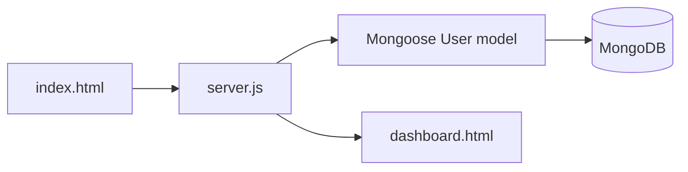

# Forge Campus Login Prototype

## Overview

Forge is a small Express/MongoDB prototype implementing registration, login, and dashboard navigation for a campus-style web interface. The browser pages are served by `server.js`, while user records are represented with a Mongoose model.

## Implemented workflow

1. A user submits registration details from the browser.
2. The server checks for an existing email.
3. The password is hashed with bcryptjs before persistence.
4. Login compares the submitted password with the stored hash.
5. Successful requests return JSON responses and can navigate to the dashboard.

## Architecture



## Technology stack

- Node.js and Express for HTTP handling.
- Mongoose/MongoDB for user persistence.
- bcryptjs for password hashing.
- HTML/CSS/JavaScript for the interface.

## Setup

```bash
npm install
npm start
```

Use an environment variable for the MongoDB URI and never commit credentials.

## Security limitations

The current prototype needs production hardening, including environment-based secrets, secure sessions/tokens, rate limiting, input validation, CSRF protection, HTTPS, and authorization checks.

See [`docs/API.md`](docs/API.md) for the implemented route summary and [`SECURITY.md`](SECURITY.md) for safe reporting and deployment guidance.

## Status

Learning/prototype project.

## License

No license is currently declared.
